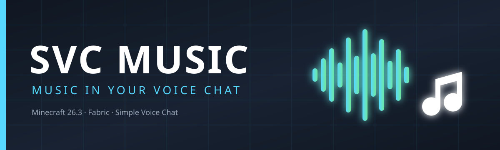
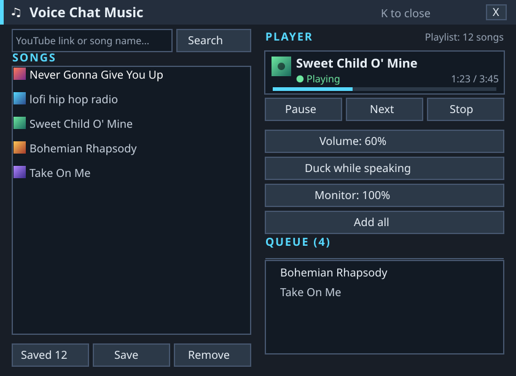

# SVC Music

Play YouTube songs, song links and whole playlists into **Simple Voice Chat** from a client-side
Minecraft mod. Everyone who can hear your voice hears the music at the same time — no server mod,
no bot account, no extra port.



## Features

- **Music and voice together** — the song keeps playing while you talk.
- **Smart ducking** — music gets quieter while you speak, then returns to full volume.
- **Search or paste a link** — find songs by name, or paste a YouTube song or playlist URL.
- **Playlists** — load every song from a playlist into the queue with one click.
- **Saved songs** — keep your favourites in a library that survives restarts.
- **Nice panel** — album art, hover tooltips, live progress bar, volume and monitor controls.

## Requirements

- Minecraft **26.3** with Fabric Loader **0.20.1+**
- [Simple Voice Chat](https://modrinth.com/mod/simple-voice-chat) **2.6.27+**
- [yt-dlp](https://github.com/yt-dlp/yt-dlp) and [ffmpeg](https://ffmpeg.org/) installed

## Install

1. Install Fabric Loader for Minecraft 26.3.
2. Put **Simple Voice Chat** and **SVC Music** in your `.minecraft/mods` folder.
3. Install `yt-dlp` and `ffmpeg` (for example `pipx install yt-dlp` and your distro's `ffmpeg` package).
4. Join a world or server that has Simple Voice Chat.

## Use

Press **K** to open the music panel.

| Control | What it does |
| --- | --- |
| Search box | Type a song name, or paste a YouTube song/playlist link |
| Search | Show matching songs |
| Results / Saved | Switch between search results and your saved songs |
| Add all | Queue every song in the current list |
| Save | Save a song, the one playing, or a link typed in the box |
| Remove | Delete the selected saved song |
| Pause / Next / Stop | Queue control |
| Volume | How loud the music is for other players |
| Duck while speaking | Turn automatic ducking on or off |
| Monitor | How loud the music is in your own headphones |

Hover any control for a tooltip, and hover a song to see its full title and length.

The same actions are available in chat:

```
/music play <query>     search and play the first match
/music pause | resume | skip | stop
/music vol <0-100>
/music save             save what is playing
/music list             list saved songs
/music panel            open the panel
```

## Good to know

- Voice chat must be **enabled and unmuted**. Music is mixed into your microphone stream, so if
  voice chat is off the panel will show `Enable voice chat to play music`.
- The talking indicator stays lit while music plays; that is how voice chat reports outgoing audio.
- Everyone in earshot hears the music, with the normal voice chat proximity and group rules.
- A server admin can set `codec=AUDIO` in the Simple Voice Chat server config for better music quality.
- Settings are in `config/vcmusic/config.json`, saved songs in `config/vcmusic/library.json`.
  If `yt-dlp` or `ffmpeg` are not found automatically, set their absolute paths there.

## Links

- [Simple Voice Chat](https://modrinth.com/mod/simple-voice-chat)
- [yt-dlp](https://github.com/yt-dlp/yt-dlp)
- [Report an issue](https://github.com/Paranthaman-K6/SVC-MUSIC/issues)
